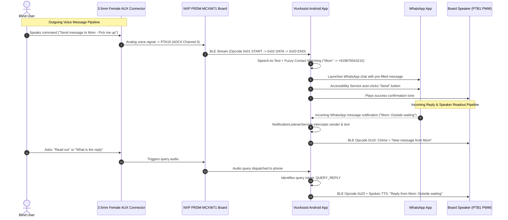

# VoxAssist IoT: NXP FRDM-MCXW71 Assistive Audio & WhatsApp Gateway
## Complete Systematic Master Project Guide & Implementation Manual

---

## 1. Executive Summary & System Architecture

**VoxAssist IoT** is an end-to-end assistive cyber-physical system designed specifically for blind and visually impaired users. It enables complete hands-free, zero-touch communication over WhatsApp using the **NXP FRDM-MCXW71** wireless microcontroller, a **female 3.5mm AUX connector** for audio/microphone input, and a **high-fidelity speaker** for spoken alerts and message readouts.

### System Flow
1. **Voice Input via Female AUX Connector:** The user connects a headset, microphone, or external audio line to the 3.5mm female AUX connector on the FRDM-MCXW71 board.
2. **Audio Sampling & BLE Streaming:** The FRDM-MCXW71 samples the analog voice signal via its high-speed ADC0 at 16 kHz (16-bit mono), packages it with lightweight framing opcodes, and streams it over Bluetooth Low Energy (BLE 5.3) to the companion mobile app.
3. **Bluetooth Discovery & Connection Tab:** The mobile companion application features a dedicated **Bluetooth Devices Tab/Segment** that scans for all nearby BLE devices, displays live signal strength (RSSI), and connects to the `FRDM-MCXW71-VOX` board with zero manual configuration.
4. **Contact Resolution & NLP Parsing:** The app transcribes the audio, runs phonetic and edit-distance fuzzy matching against the phone's address book to resolve the contact (e.g. matching "Ashis" or "Mum" to "Ashish Shettigar" or "Mom"), and extracts the message body.
5. **Hands-Free WhatsApp Dispatch:** An Android Accessibility Service automatically opens the WhatsApp chat, populates the message, clicks **"Send"**, and returns back to VoxAssist—100% hands-free without any screen taps required.
6. **Incoming WhatsApp Reply Interception:** An Android `NotificationListenerService` detects incoming replies from WhatsApp in real time.
7. **Speaker Notification & Interactive Voice Readout:**
   - When a reply arrives, the app and the FRDM-MCXW71 board speaker announce: *"New message from [Contact Name]"*.
   - When the user asks: *"Read out"* or *"What is the reply"*, the system reads out the message body aloud through the phone and microcontroller speaker.



---

## 2. Hardware Bill of Materials (BOM) & Specifications

| Component | Specification / Part Number | Role in Project | Interface to MCU |
| :--- | :--- | :--- | :--- |
| **Microcontroller Board** | **NXP FRDM-MCXW71** (OM15080-K32W or FRDM-MCXW71) | Core BLE 5.3 Gateway & DSP (Cortex-M33 @ 96 MHz) | Onboard USB-C Debugger (MCU-Link) |
| **Audio Input Connector** | **3.5mm Female AUX Jack** (4-pole TRRS or 3-pole TRS) | Voice input from lapel mic, headset, or AUX line | Analog ADC0 (PTA16), Jack Detect (PTA21), PTT (PTB0) |
| **Audio Conditioning** | 10µF Electrolytic Capacitor + Dual 10kΩ Resistors | AC-coupling & 1.65V DC biasing for ADC0 | Connected between AUX Tip and PTA16 |
| **Audio Amplifier** | **PAM8403** (3W Stereo Class-D) or **MAX98357A** (I2S Mono) | Amplifies audio output to drive speaker | CTIMER0 PWM (PTB1) + Amp Mute (PTB2) |
| **Speaker** | **8Ω 1W to 2W Micro-Speaker** (36mm or 40mm) | Spoken feedback & acoustic notification chimes | Connected across amplifier outputs (L+ / L-) |
| **RC Filter** | 1kΩ Resistor + 10nF Ceramic Capacitor | Low-pass filter smoothing PWM into analog audio | Connected between PTB1 and Amplifier Audio IN |
| **Tactile Push-Button** | Momentary Tactile Switch (or AUX inline switch) | Physical Push-to-Talk (PTT) trigger for blind user | PTB0 (Arduino D4) to Ground |
| **Mobile Smartphone** | Android 8.0 to Android 15+ with WhatsApp installed | Companion App, Speech Recognition, NLP, WhatsApp Gateway | Bluetooth Low Energy 5.3 |

---

## 3. Hardware Pinout & Wiring Connections (FRDM-MCXW71)

### 3.1. Female 3.5mm AUX Connector Wiring
The standard 3.5mm audio jack uses the **CTIA / AHJ standard** (Tip = Left Audio, Ring 1 = Right Audio / Jack Detect, Ring 2 = Ground, Sleeve = Microphone / PTT Switch):

```
     [=== TIP ===|=== RING 1 ===|=== RING 2 ===|=== SLEEVE ===]====( Cable )
          |              |              |              |
        Audio         Detect          Ground          Mic /
       (PTA16)        (PTA21)         (GND)          (PTB0)
```

#### Pin Assignment Table:
| AUX Jack Terminal | Signal Name | FRDM-MCXW71 Pin | Arduino Header Pin | Circuit Conditioning Details |
| :--- | :--- | :--- | :--- | :--- |
| **Tip** | Audio In (Left/Mono) | **PTA16** | **Arduino A0** | Connect in series with a **10µF AC-coupling capacitor**. Bias with a voltage divider (**10kΩ to 3.3V** and **10kΩ to GND**) to center the AC wave at 1.65V DC for ADC0. |
| **Ring 1** | Jack Detect / Right | **PTA21** | **Arduino D2** | Digital Input with internal pull-up enabled. Connects to the AUX connector switch pin; pulls to GND when 3.5mm plug is inserted. |
| **Ring 2** | Ground | **GND** | **GND Header Pin** | Common system analog and digital ground reference. |
| **Sleeve** | Mic In / Inline PTT | **PTB0** | **Arduino D4** | Digital Input with internal pull-up enabled. Connects to the tactile inline switch; pulls to GND when user holds PTT. |

#### Biasing Schematic for AUX ADC (PTA16):
```
  3.3V Rail
     |
    [10kΩ] (R1)
     |
     +------------ PTA16 (ADC0 Channel 0 on FRDM-MCXW71)
     |       |
     |     [10µF] (C1 Capacitor)
     |       |
    [10kΩ]   +---- AUX Female Tip (Audio In)
     (R2)
     |
    GND
```

---

### 3.2. Speaker & Audio Amplifier Wiring

#### Pin Assignment Table:
| Component Pin | Signal Function | FRDM-MCXW71 Pin | Arduino Header Pin | Description |
| :--- | :--- | :--- | :--- | :--- |
| **Amp Audio IN+** | PWM Audio Signal | **PTB1** | **Arduino D3** | CTIMER0 Match 1 Output configured for high-speed PWM tone/speech generation. Passes through a 1kΩ resistor and 10nF capacitor to ground (RC low-pass filter). |
| **Amp SHDN / Mute** | Amplifier Mute | **PTB2** | **Arduino D5** | GPIO Output (Active HIGH = Unmute, LOW = Mute / Shutdown). Prevents idle pops and hissing when no audio is playing. |
| **Amp VDD** | Amplifier Power | **5V or 3.3V** | **5V / 3.3V Header** | Direct power supply from FRDM development board. |
| **Amp GND** | Power Ground | **GND** | **GND Header** | Common Ground. |
| **Speaker (+)** | Positive Terminal | **Amp SPK+** | Direct terminal | Connected to 8Ω 1W-2W speaker. |
| **Speaker (-)** | Negative Terminal | **Amp SPK-** | Direct terminal | Connected to 8Ω 1W-2W speaker. |

#### Low-Pass RC Filter Schematic:
```
  FRDM-MCXW71 PTB1 (Arduino D3)
         |
       [1kΩ] (R_filter)
         |
         +---------------- PAM8403 Audio IN+
         |
       [10nF] (C_filter)
         |
        GND
```

---

## 4. Bluetooth Low Energy (BLE 5.3) Protocol Specification

### 4.1. GATT Architecture & UUIDs
The FRDM-MCXW71 exposes a custom 128-bit primary GATT service matching the companion app:

| GATT Entity | UUID | Properties | Data Direction | Description |
| :--- | :--- | :--- | :--- | :--- |
| **Primary Service** | `0000FFF0-0000-1000-8000-00805F9B34FB` (`0xFFF0`) | Primary | — | VoxAssist Custom Assistive Service |
| **Audio/Command TX** | `0000FFF1-0000-1000-8000-00805F9B34FB` (`0xFFF1`) | **Notify** | **MCU &rarr; Phone** | Streams audio chunks & opcodes from AUX mic to phone |
| **Audio/Speaker RX** | `0000FFF2-0000-1000-8000-00805F9B34FB` (`0xFFF2`) | **Write Without Response** | **Phone &rarr; MCU** | Sends notification alerts & reply readout text to board speaker |
| **Status & Config** | `0000FFF3-0000-1000-8000-00805F9B34FB` (`0xFFF3`) | **Read, Notify** | Bi-directional | AUX jack insertion status, battery & hardware health |
| **CCCD Descriptor** | `00002902-0000-1000-8000-00805F9B34FB` | Read, Write | Phone &rarr; MCU | Client Characteristic Configuration Descriptor (enables Notify) |

### 4.2. Protocol Framing Opcodes
All BLE packets transmitted over characteristic `0xFFF1` and `0xFFF2` use a 1-byte opcode prefix:

| Opcode | Hex | Source | Payload | Description |
| :--- | :--- | :--- | :--- | :--- |
| `OPCODE_START` | `0x01` | FRDM-MCXW71 | Empty (1 byte total) | PTT button pressed / Audio recording started. Companion app clears data buffer. |
| `OPCODE_DATA` | `0x02` | FRDM-MCXW71 | PCM Samples (120-240B) | Audio chunk from AUX ADC. App appends to incoming buffer. |
| `OPCODE_END` | `0x03` | FRDM-MCXW71 | Empty (1 byte total) | PTT button released. App flushes buffer, recognizes speech, and sends via WhatsApp. |
| `OPCODE_NOTIF_ALERT`| `0x10` | Companion App | ASCII String (`"New message from Mom"`) | Intercepted WhatsApp notification. Board speaker plays double chime + alert. |
| `OPCODE_READOUT` | `0x20` | Companion App | ASCII String (`"Reply from Mom: ..."`)| User asked "Read out" / "What is the reply". Board speaker plays reply text. |
| `OPCODE_STATUS` | `0x30` | FRDM-MCXW71 | Bitmask (Jack, Batt, RSSI) | Telemetry status query. |

---

## 5. Microcontroller C Firmware (`firmware/main.c`)

The complete production firmware is implemented at [`firmware/main.c`](file:///c:/Users/ashis/.gemini/antigravity-ide/scratch/Iotproject/firmware/main.c) using the NXP MCUXpresso SDK and EdgeFast Bluetooth Host Stack:

### Key Subsystems in Firmware:
1. **Clock & Board Initialization:** Configures Cortex-M33 at 96 MHz and FRO High-Frequency clocks for low-jitter PWM.
2. **AUX ADC0 Sampling:** Configures `LPADC0` on PTA16 for 16-bit single-ended conversions triggered at 16 kHz.
3. **CTIMER0 Audio PWM & Amp Control:** Generates acoustic frequencies on PTB1 and drives the PTB2 amplifier mute pin.
4. **EdgeFast BLE Stack:** Configures GAP peripheral advertising as `"FRDM-MCXW71-VOX"` with service `0xFFF0`.
5. **GATT Characteristic Receiver:** Listens for `0x10` (Notification Alert) and `0x20` (Readout Reply) to drive the board speaker.
6. **Background Loop:** Reads AUX Jack detect (`PTA21`), PTT button (`PTB0`), samples audio, and notifies the phone.

---

## 6. Companion Mobile Application Architecture

The application is structured as a native Android app with an integrated web runtime (accessible both as a native Android APK and as a standalone Progressive Web App / Web Bluetooth portal).

### 6.1. Segmented Navigation Tabs
The UI provides 5 dedicated segmented tabs:
1. **🎙️ Voice Assist:** Core voice interaction, tactile Push-to-Talk button, real-time waveform visualizer, NLP intent card, and spoken feedback banner.
2. **📡 Bluetooth Devices:** Full-featured BLE scanner that lists all available Bluetooth devices, live RSSI signal bars, target MCU highlight, and 1-tap connection.
3. **🔔 WhatsApp & Speaker:** Incoming WhatsApp replies feed, notification listener status, and interactive voice query buttons ("Read out" / "What is the reply").
4. **👥 Contacts:** Address book synchronized from native phone contacts with real-time search, category filtering, and 1-tap voice dispatching.
5. **🔌 FRDM-MCXW71 Pins:** Complete interactive pinout tables and live BLE buffer telemetry monitor.

---

### 6.2. Dedicated Bluetooth Scanner Hub & Connection Engine

Located in [`android/app/src/main/java/com/voxassist/iot/MainActivity.kt`](file:///c:/Users/ashis/.gemini/antigravity-ide/scratch/Iotproject/android/app/src/main/java/com/voxassist/iot/MainActivity.kt):

#### Scan Configuration:
- Utilizes `BluetoothLeScanner` with `ScanSettings.SCAN_MODE_LOW_LATENCY`.
- Continuously scans and builds a registry of nearby devices (`scannedDevices`).
- Automatically categorizes devices with names containing `FRDM`, `MCXW71`, or `Vox` as target microcontrollers.
- When `FRDM-MCXW71-VOX` is discovered, auto-connection is initiated seamlessly.

#### Robust Connection & GATT Discovery Sequence:
1. Calls `device.connectGatt(context, false, gattCallback)`.
2. Upon `STATE_CONNECTED`, immediately negotiates high throughput MTU:
   ```kotlin
   gatt.requestMtu(512)
   ```
3. In `onMtuChanged`, initiates service discovery:
   ```kotlin
   gatt.discoverServices()
   ```
4. In `onServicesDiscovered`, locates `0xFFF0` and characteristic `0xFFF1`, enables local notifications, and writes the CCCD descriptor (`0x2902`):
   ```kotlin
   val descriptor = charTx.getDescriptor(CCCD_UUID)
   descriptor.value = BluetoothGattDescriptor.ENABLE_NOTIFICATION_VALUE
   gatt.writeDescriptor(descriptor)
   ```
5. Updates the UI and speaks confirmation aloud: *"Connected to FRDM-MCXW71. AUX microphone and speaker ready."*

---

### 6.3. WhatsApp Notification Listener Service (`VoxNotificationListenerService`)

Declared at [`android/app/src/main/java/com/voxassist/iot/VoxNotificationListenerService.kt`](file:///c:/Users/ashis/.gemini/antigravity-ide/scratch/Iotproject/android/app/src/main/java/com/voxassist/iot/VoxNotificationListenerService.kt):

- Binds to Android's notification pipeline (`NotificationListenerService`).
- Filters notifications from packages `com.whatsapp` and `com.whatsapp.w4b`.
- Ignores background sync events (e.g. "Checking for new messages" or "WhatsApp Web is active").
- Extracts:
  - **Sender Name:** from `Notification.EXTRA_TITLE`
  - **Message Body:** from `Notification.EXTRA_TEXT` / `Notification.EXTRA_BIG_TEXT`
- Dispatches notification to `MainActivity`:
  1. Triggers TTS voice announcement: *"New message from [Sender]."*
  2. Sends BLE Opcode `0x10` to the FRDM-MCXW71 speaker characteristic (`0xFFF2`) to trigger the board chime.
  3. Saves the message for subsequent query readouts.

---

### 6.4. Interactive Voice Query ("Read out" / "What is the reply")

When the blind user hears the notification announcement, they can speak naturally:
> **"Read out"** or **"What is the reply"** or **"What did Mom say"**

#### Processing Logic:
```kotlin
private fun isReplyReadoutQuery(text: String): Boolean {
    val lower = text.lowercase()
    return lower.contains("read out") ||
           lower.contains("what is the reply") ||
           lower.contains("read the reply") ||
           lower.contains("read reply") ||
           lower.contains("read message") ||
           lower.contains("what is the message") ||
           lower.contains("what did they say")
}
```
1. Retrieves `VoxNotificationListenerService.getLastReplyFormatted()`.
2. Speaks aloud: *"Message from Mom: I am outside the clinic, please pick me up."*
3. Sends packet `[0x20, "Reply from Mom: ..."]` over BLE to the FRDM-MCXW71 board speaker.

---

### 6.5. WhatsApp Hands-Free Auto-Send (`WhatsAppAccessibilityService`)

Declared at [`android/app/src/main/java/com/voxassist/iot/WhatsAppAccessibilityService.kt`](file:///c:/Users/ashis/.gemini/antigravity-ide/scratch/Iotproject/android/app/src/main/java/com/voxassist/iot/WhatsAppAccessibilityService.kt):

1. User speaks: *"Send message to Mom - I am outside"*
2. App generates intent: `https://api.whatsapp.com/send?phone=919876543210&text=I%20am%20outside`
3. Sets `autoSendPending = true`
4. WhatsApp opens with pre-filled message text.
5. The Accessibility Service scans the active window:
   - Matches View ID `com.whatsapp:id/send` or content description `"Send"`.
   - Executes `performAction(AccessibilityNodeInfo.ACTION_CLICK)`.
6. After 1.5 seconds, performs `GLOBAL_ACTION_BACK` to return to VoxAssist automatically.

---

## 7. Systematic Order-Wise Execution Runbook

Follow these steps sequentially to set up, flash, wire, and operate the entire system:

### Phase 1: Hardware Wiring
1. **Connect Female AUX Connector:**
   - Solder/wire Tip &rarr; 10µF capacitor &rarr; PTA16 (Arduino A0). Add 10k/10k divider to 3.3V and GND.
   - Wire Ring 1 &rarr; PTA21 (Arduino D2).
   - Wire Ring 2 &rarr; GND.
   - Wire Sleeve &rarr; PTB0 (Arduino D4).
2. **Connect Speaker & Amplifier:**
   - Wire PAM8403 Audio IN+ &rarr; 1kΩ resistor &rarr; PTB1 (Arduino D3). Add 10nF cap to GND.
   - Wire PAM8403 SHDN &rarr; PTB2 (Arduino D5).
   - Wire PAM8403 VDD & GND &rarr; 5V / 3.3V and GND headers.
   - Connect 8Ω speaker to PAM8403 output terminals.
3. **Power On Board:**
   - Plug USB-C cable into the MCU-Link debugger port (J1) of the FRDM-MCXW71.

### Phase 2: Firmware Compilation & Flashing
1. Launch **MCUXpresso IDE** (v11.8+ or MCUXpresso for VS Code).
2. Select **Import SDK Examples** &rarr; Board: **FRDM-MCXW71** &rarr; Project: `wireless_examples/bluetooth/edgefast_bluetooth`.
3. Replace `source/main.c` with the code in [`firmware/main.c`](file:///c:/Users/ashis/.gemini/antigravity-ide/scratch/Iotproject/firmware/main.c).
4. Click **Build** (`Ctrl+B`) and ensure 0 errors.
5. Click **Debug** / **Flash Device** to program the board.
6. Open serial monitor (COM port, 115200 baud 8-N-1):
   - Output verifies: `[BLE] Advertising active as "FRDM-MCXW71-VOX"`
   - Output verifies: `[AUX] Female 3.5mm connector initialized: ADC on PTA16`
   - Output verifies: `[SPEAKER] Audio PWM initialized on PTB1`

### Phase 3: Android App Setup & Permissions
1. Install the VoxAssist app onto your phone (via Android Studio build or PWA install).
2. When prompted, grant:
   - **Microphone / Record Audio**
   - **Read Contacts**
   - **Nearby Devices / Bluetooth Scan & Connect**
   - **Notification Access** (Settings &rarr; Apps &rarr; Special Access &rarr; Notification Access &rarr; Enable **VoxAssist**)
   - **Accessibility Service** (Settings &rarr; Accessibility &rarr; Installed Apps &rarr; Enable **VoxAssist**)

### Phase 4: Bluetooth Pairing via New Bluetooth Segment Tab
1. Open VoxAssist on your phone.
2. Tap the **"📡 Bluetooth Devices"** segment at the top.
3. Tap **"🔍 Scan for Devices"**.
4. The list displays all nearby Bluetooth peripherals with live RSSI meters.
5. Tap **"Connect"** on the highlighted **FRDM-MCXW71-VOX** card.
6. The app negotiates 512-byte MTU, subscribes to notifications, and speaks:
   > *"Connected to FRDM-MCXW71. AUX microphone and speaker ready."*

### Phase 5: Voice Message Sending Test
1. Plug your microphone or headset into the female AUX jack (or hold the PTT button on PTB0).
2. Speak clearly into the microphone:
   > *"Send message to Mom - I am outside the clinic, please pick me up"*
3. Release the button.
4. Spoken confirmation announces: *"Sending WhatsApp message to Mom automatically."*
5. WhatsApp opens, the message is auto-sent, and the app returns to VoxAssist.

### Phase 6: WhatsApp Reply & Interactive Speaker Readout Test
1. Have Mom reply to your message on WhatsApp (e.g. *"I am on my way, be ready in 5 mins"*).
2. VoxAssist intercepts the notification.
3. The board speaker plays a high double chime, and the phone announces:
   > *"New message from Mom."*
4. Press PTT or speak into the AUX microphone:
   > *"What is the reply"* or *"Read out"*
5. The system speaks aloud through the phone and microcontroller speaker:
   > *"Message from Mom: I am on my way, be ready in 5 mins."*

---

## 8. Summary of Project Files

- **Master Documentation:** [`PROJECT_MASTER_GUIDE.md`](file:///c:/Users/ashis/.gemini/antigravity-ide/scratch/Iotproject/PROJECT_MASTER_GUIDE.md)
- **Microcontroller Firmware (C):** [`firmware/main.c`](file:///c:/Users/ashis/.gemini/antigravity-ide/scratch/Iotproject/firmware/main.c)
- **Android Manifest:** [`android/app/src/main/AndroidManifest.xml`](file:///c:/Users/ashis/.gemini/antigravity-ide/scratch/Iotproject/android/app/src/main/AndroidManifest.xml)
- **Android Native Controller:** [`android/app/src/main/java/com/voxassist/iot/MainActivity.kt`](file:///c:/Users/ashis/.gemini/antigravity-ide/scratch/Iotproject/android/app/src/main/java/com/voxassist/iot/MainActivity.kt)
- **WhatsApp Accessibility Service:** [`android/app/src/main/java/com/voxassist/iot/WhatsAppAccessibilityService.kt`](file:///c:/Users/ashis/.gemini/antigravity-ide/scratch/Iotproject/android/app/src/main/java/com/voxassist/iot/WhatsAppAccessibilityService.kt)
- **WhatsApp Notification Listener:** [`android/app/src/main/java/com/voxassist/iot/VoxNotificationListenerService.kt`](file:///c:/Users/ashis/.gemini/antigravity-ide/scratch/Iotproject/android/app/src/main/java/com/voxassist/iot/VoxNotificationListenerService.kt)
- **Interactive Web / PWA App:** [`index.html`](file:///c:/Users/ashis/.gemini/antigravity-ide/scratch/Iotproject/index.html)
- **Frontend Logic & Bluetooth Hub:** [`app.js`](file:///c:/Users/ashis/.gemini/antigravity-ide/scratch/Iotproject/app.js)
- **High-Contrast Theme & Tabs:** [`style.css`](file:///c:/Users/ashis/.gemini/antigravity-ide/scratch/Iotproject/style.css)

