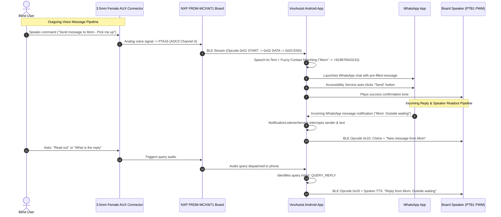

# VoxAssist IoT - Voice-to-WhatsApp Assistive Gateway
### NXP FRDM-MCXW71 Wireless MCU (BLE 5.3) + 3.5mm Female AUX Mic In + Onboard Speaker Feedback

[](https://github.com/ashishshettigar09/VoxAssist/actions/workflows/build-apk.yml)
[](#)
[](#)
[](#)

An end-to-end assistive cyber-physical system designed for blind and visually impaired users. It enables 100% hands-free, zero-touch voice communication over WhatsApp using the **NXP FRDM-MCXW71** microcontroller, an analog **female 3.5mm AUX connector** for audio input, and an **amplified speaker** for spoken alerts and interactive message readouts.

---

## 📸 Key Features & Capabilities

1. **Crisp Professional White Theme (High-Contrast Accessibility):**
   - Clean, light, professional UI engineered for maximum legibility and ease of access.
   - High-contrast typography (`#0f172a` deep slate on `#ffffff` surfaces) with prominent tactile touch targets (&ge; 48px).
   - Instant theme toggle between **☀️ Light White Theme** and **🌙 Dark Contrast Theme**.

2. **⚙️ Settings & Connected Devices Section:**
   - **Connected Microcontroller:** Displays live connection status for `FRDM-MCXW71-VOX`, real-time RSSI signal strength meter, MAC address, negotiated MTU (512 Bytes), and buttons to Ping Speaker, Reconnect, or Disconnect.
   - **Nearby Bluetooth Devices:** Live scanner that lists all available Bluetooth peripherals in the vicinity with animated signal strength bars, target MCU badges, and 1-tap fast connection.
   - **Audio & Accessibility Options:** Adjust TTS speech rate (0.85x to 1.4x), toggle spoken audio feedback, and manage Android Accessibility and Notification Access services.

3. **3.5mm Female AUX Audio Interface:**
   - Connects any standard 3.5mm headset, lapel microphone, or external audio source.
   - Audio is digitized via high-speed 16-bit ADC0 on pin **PTA16** (Arduino A0) at 16,000 Hz.
   - 3.5mm Jack insertion detection on pin **PTA21** (Arduino D2).
   - Push-to-Talk (PTT) / inline microphone button on pin **PTB0** (Arduino D4).

4. **Speaker Notification & Interactive Spoken Readout:**
   - Audio output driven by CTIMER0 PWM on pin **PTB1** (Arduino D3) into a PAM8403 / MAX98357A amplifier and 8Ω speaker.
   - Anti-pop amplifier mute pin on **PTB2** (Arduino D5).
   - When a WhatsApp reply arrives, the phone and microcontroller speaker announce: *"New message from [Contact Name]"*.
   - When the user asks: *"Read out"* or *"What is the reply"*, VoxAssist reads out the reply body aloud through the speaker!

5. **100% Hands-Free WhatsApp Auto-Send:**
   - Android Accessibility Service automatically clicks the **"Send"** button in WhatsApp without requiring any screen touches, then returns back to VoxAssist automatically.

---

## 🔄 System Architecture Sequence



---

## 🔌 Hardware Pinout & Wiring Connections (FRDM-MCXW71)

### 1. Female 3.5mm AUX Connector (Audio In & Push-to-Talk)

Standard CTIA / AHJ 3.5mm TRRS Connector Pinout:
```
     [=== TIP ===|=== RING 1 ===|=== RING 2 ===|=== SLEEVE ===]====( Cable )
          |              |              |              |
        Audio         Detect          Ground          Mic /
       (PTA16)        (PTA21)         (GND)          (PTB0)
```

| AUX Terminal | Signal Function | FRDM-MCXW71 Pin | Arduino Header | Circuit Details |
| :--- | :--- | :--- | :--- | :--- |
| **Tip** | Audio In (Left/Mono) | **PTA16** | **Arduino A0** | LPADC0 Ch 0. AC-coupled via **10µF capacitor** and biased to 1.65V DC with a **10kΩ/10kΩ divider** to 3.3V. |
| **Ring 1** | Jack Insertion Detect | **PTA21** | **Arduino D2** | Digital Input with internal pull-up (detects cable insertion). |
| **Ring 2** | Ground Reference | **GND** | **GND** | Common system ground. |
| **Sleeve** | Mic / Inline PTT Switch| **PTB0** | **Arduino D4** | Digital Input with internal pull-up (Active LOW when button held). |

#### Biasing Schematic for AUX ADC (PTA16):
```
  3.3V Rail
     |
    [10kΩ] (R1)
     |
     +------------ PTA16 (ADC0 Channel 0 on FRDM-MCXW71)
     |       |
     |     [10µF] (C1 Capacitor)
     |       |
    [10kΩ]   +---- AUX Female Tip (Audio In)
     (R2)
     |
    GND
```

---

### 2. Speaker & Audio Amplifier Wiring

| Component Pin | Signal Function | FRDM-MCXW71 Pin | Arduino Header | Circuit Details |
| :--- | :--- | :--- | :--- | :--- |
| **Amp Audio IN+** | Speaker PWM Audio | **PTB1** | **Arduino D3** | CTIMER0 PWM Match 1 output smoothed through a **1kΩ + 10nF RC low-pass filter**. |
| **Amp SHDN / Mute** | Amplifier Mute | **PTB2** | **Arduino D5** | GPIO Output (Active HIGH = Unmute, LOW = Anti-pop mute). |
| **Amp VDD & GND** | Power Supply | **5V / 3.3V & GND**| **Power Header**| Direct power rails from board. |
| **Speaker (+ / -)** | Audio Out | **Amp SPK+ / SPK-**| Direct | Drives an **8Ω 1W–2W micro-speaker**. |

#### Low-Pass RC Filter Schematic:
```
  FRDM-MCXW71 PTB1 (Arduino D3)
         |
       [1kΩ] (R_filter)
         |
         +---------------- PAM8403 Audio IN+
         |
       [10nF] (C_filter)
         |
        GND
```

---

## 📡 Bluetooth Low Energy (BLE 5.3) GATT Specification

- **Device Advertising Name:** `FRDM-MCXW71-VOX`
- **Primary Service UUID:** `0000FFF0-0000-1000-8000-00805F9B34FB` (`0xFFF0`)
- **Characteristic TX (`0xFFF1` - Notify):** Streams audio & framing opcodes from MCU to Phone (`0x01` START, `0x02` DATA, `0x03` END).
- **Characteristic RX (`0xFFF2` - Write):** Sends notification chime alert (`0x10`) and reply readout text (`0x20`) from Phone to MCU Speaker.
- **Characteristic Status (`0xFFF3` - Read/Notify):** Reports hardware diagnostics & AUX jack presence.

### Protocol Framing Opcodes:
| Opcode | Hex | Source | Description |
| :--- | :--- | :--- | :--- |
| `OPCODE_START` | `0x01` | FRDM-MCXW71 | AUX PTT button pressed / stream begin. App resets buffer. |
| `OPCODE_DATA` | `0x02` | FRDM-MCXW71 | Streaming PCM audio chunk from AUX ADC (16kHz / 16-bit mono). |
| `OPCODE_END` | `0x03` | FRDM-MCXW71 | AUX PTT button released. App flushes buffer and auto-sends to WhatsApp. |
| `OPCODE_NOTIF_ALERT`| `0x10`| Companion App | Intercepted WhatsApp notification. Board speaker plays double chime + alert. |
| `OPCODE_READOUT` | `0x20` | Companion App | User asked "Read out" / "What is the reply". Board speaker plays reply text. |

---

## 📱 How to Get the App on Your Phone (Download APK)

### Method 1: Instant Cloud APK Download via GitHub Actions
A GitHub Actions workflow is active at [`.github/workflows/build-apk.yml`](.github/workflows/build-apk.yml):
1. Go to the **[Actions tab on GitHub](https://github.com/ashishshettigar09/VoxAssist/actions)**.
2. Click on the latest workflow run: **"Build VoxAssist APK"**.
3. Under **Artifacts**, download **`VoxAssist-Debug-APK.zip`**.
4. Unzip and transfer `app-debug.apk` to any Android phone.

### Method 2: Instant PWA Install (Zero Compile Time)
1. Open [`index.html`](index.html) in Chrome or Edge on your phone.
2. Tap the **"📱 Install App"** button in the header.
3. The app installs directly onto your phone's home screen with the VoxAssist launcher icon, offline support, and full Web Bluetooth capability!

### Method 3: Build in Android Studio
1. Open **Android Studio**.
2. Select **Open** &rarr; choose the `android` folder.
3. Click **Build > Build Bundle(s) / APK(s) > Build APK(s)**.
4. APK output: `android/app/build/outputs/apk/debug/app-debug.apk`.

---

## 📂 Repository Structure

```
Iotproject/
├── PROJECT_MASTER_GUIDE.md # Comprehensive Engineering & Runbook Guide
├── README.md               # Master GitHub Documentation
├── index.html              # Multi-Tab White Theme Companion App (Settings Hub, Replies, Pins)
├── style.css               # Crisp High-Contrast Accessible White Theme Styles
├── app.js                  # Frontend Controller, Bluetooth Hub & NLP Engine
├── .github/workflows/
│   └── build-apk.yml       # Cloud APK Automated Build Workflow
├── firmware/
│   └── main.c              # NXP FRDM-MCXW71 Production C Firmware (ADC, PWM, BLE 5.3)
└── android/
    ├── AndroidManifest.xml # Permissions, Accessibility & Notification Listener
    └── app/src/main/java/com/voxassist/iot/
        ├── MainActivity.kt                  # Bluetooth Hub, Audio Streaming & NLP Engine
        ├── VoxNotificationListenerService.kt# Real-time WhatsApp Notification Listener
        └── WhatsAppAccessibilityService.kt  # Hands-Free WhatsApp Auto-Clicker
```

---

## ⚡ Systematic Order-Wise Setup Runbook

### Step 1: Hardware Assembly
1. Connect the female 3.5mm AUX connector to the FRDM-MCXW71 board according to the pinout table above (PTA16 ADC0, PTA21 Jack Detect, PTB0 PTT).
2. Wire the PAM8403 / MAX98357A amplifier audio input to PTB1 (Arduino D3 via 1kΩ + 10nF filter) and mute to PTB2 (Arduino D5). Connect the 8Ω speaker across the amplifier output.
3. Connect the board via USB-C to your computer.

### Step 2: Flash Microcontroller Firmware
1. Open **MCUXpresso IDE** with SDK for **FRDM-MCXW71**.
2. Flash [`firmware/main.c`](firmware/main.c) onto the board.
3. Serial monitor (115200 baud) verifies:
   - `[BLE] Advertising active as "FRDM-MCXW71-VOX"`
   - `[AUX] Female 3.5mm connector initialized: ADC on PTA16`
   - `[SPEAKER] Audio PWM initialized on PTB1`

### Step 3: Connect via Settings & Devices Tab
1. Open VoxAssist on your smartphone.
2. Tap the **"⚙️ Settings & Devices"** tab.
3. Tap **"🔍 Scan Nearby Devices"**.
4. The app lists all nearby Bluetooth devices. Tap **"Connect"** on the highlighted **FRDM-MCXW71-VOX** card.
5. Voice announces: *"Connected to FRDM-MCXW71. AUX microphone and speaker ready."*

### Step 4: Voice-to-WhatsApp Test
1. Speak into the AUX microphone / headset:
   > *"Send message to Mom - I am outside the clinic, please pick me up"*
2. The app transcribes the audio, resolves the contact, opens WhatsApp, auto-clicks "Send", and returns to VoxAssist automatically!

### Step 5: Incoming WhatsApp Reply & Interactive Readout Test
1. When Mom replies on WhatsApp (*"I am outside waiting in the car"*):
2. The phone and the microcontroller speaker announce:
   > *"New message from Mom."* (accompanied by an acoustic chime).
3. Say:
   > *"What is the reply"* or *"Read out"*
4. The system speaks aloud through the phone and board speaker:
   > *"Message from Mom: I am outside waiting in the car."*
